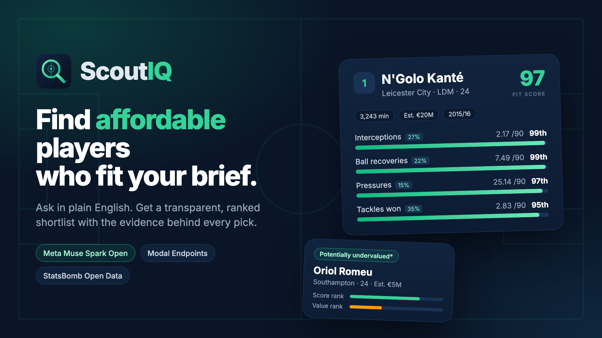

# ScoutIQ



An AI scouting assistant for clubs that can't afford a scouting department.

Ask for a player in plain English: *"three midfielders under 25 who progress the ball, help defensively and
cost under €15 million."* ScoutIQ returns a ranked shortlist with the evidence behind every pick. You can
compare players and refine with follow-ups like *"increase the budget to €25 million."*

## How it works

1. **Interpret:** Meta's Muse Spark Open turns your request into a strict, validated query.
2. **Rank:** plain Python scores players on percentile-based statistics. The model never picks the players.
3. **Explain:** each pick shows its score breakdown, strengths, trade-offs and missing data.

If the model fails or returns something invalid, a rule-based parser takes over and the app says so.

## Run it

Requires Python 3.11+ and Node 20+.

```bash
git clone https://github.com/palashpawar/scoutiq.git && cd scoutiq

# Backend (terminal 1)
cd backend && python3 -m venv .venv && .venv/bin/pip install -r requirements.txt
.venv/bin/uvicorn app.main:app --port 8000

# Frontend (terminal 2)
cd frontend && npm install && npm run dev
```

Open http://localhost:3000. It works without an API key, in a labelled demo mode.

**To use the Meta model**, copy `.env.example` to `.env` and fill in your Modal endpoint:

```
META_API_BASE_URL=<your-endpoint-url>/v1
META_API_KEY=wk-<token-id>.ws-<token-secret>
META_MODEL=meta-models/Muse-Spark-Open-816B-A42B
```

`.env.example` also covers Meta's own Model API and other settings.

## Tests

```bash
cd backend && .venv/bin/python -m pytest -q
```

## Data and limitations

Real players from the **Premier League 2015/16** season ([StatsBomb Open Data](https://github.com/statsbomb/open-data))
with market-value estimates from [transfermarkt-datasets](https://github.com/dcaribou/transfermarkt-datasets).
It's a historical season, so treat ScoutIQ as a demonstration, not a live transfer tool. Values are estimates,
not fees, and one season of statistics can't prove tactical fit. Defenders and goalkeepers aren't supported yet.

## Licence

Code is [MIT](LICENSE). Event data provided by StatsBomb; market values from transfermarkt-datasets (CC0).
